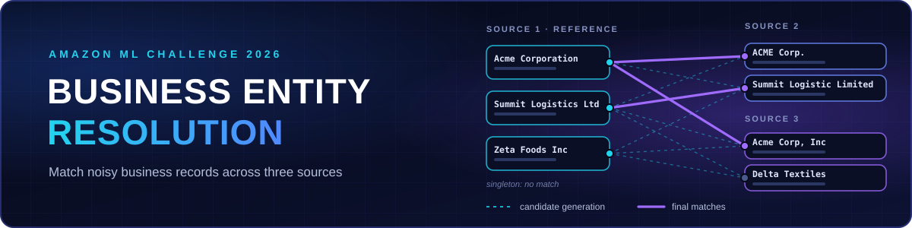
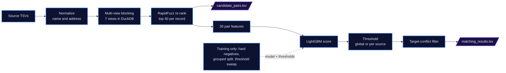

<p align="center">
  
</p>

<p align="center">
  <b>Resolve noisy business records across three independent sources and produce matching entity IDs for each Source 1 reference record.</b>
</p>

<p align="center">
  <a href="#pipeline">
    
  </a>
  <a href="#outputs">
    
  </a>
</p>

<p align="center">
  <sub><a href="#overview">Overview</a> · <a href="#pipeline">Pipeline</a> · <a href="#matching-strategy">Matching Strategy</a> · <a href="#evaluation">Evaluation</a> · <a href="#outputs">Outputs</a> · <a href="#reproducibility">Reproducibility</a></sub>
</p>

## Overview

The challenge provides three sources of business records with no shared identifier. Source 1 is the deduplicated reference. Each Source 1 record can match zero, one or several records in Source 2 and Source 3.

| ✏️ **Typos & word order** | 🏷️ **Abbreviations & legal suffixes** | 📍 **Missing address parts** | 🔤 **Formatting & transliteration** |
|:---:|:---:|:---:|:---:|
| Misspelt or reordered names | `Corp` / `Corporation`, `St` / `Street` | No postal code or unit | Accents, case, punctuation |

<h2 id="pipeline">Pipeline</h2>



- **Two phases:** `train.py` fits the model and saves it with its thresholds and config to `artifacts/`. `predict.py` and `evaluate.py` reload exactly that configuration.
- **Candidates are what the model scores:** blocking and string-similarity re-ranking build a pool of up to 40 candidates per Source 1 record, and that pool is `candidate_pairs.tsv`.
- **Conservative clean-up:** if several Source 1 records claim the same Source 2/3 record, only claims within 0.03 of the highest probability survive. One-to-many matches are never removed.

## Matching Strategy

| 🧹 **Normalization** | 🔎 **Candidate generation** |
|:---|:---|
| ASCII lowercasing, punctuation removal, business and address abbreviation expansion, legal suffixes stripped into a "core" name. Street numbers, postal codes and units are extracted. | Seven DuckDB join views: name tokens, address tokens, name 4-grams, address 5-grams, postal code, sorted core name, street numbers. Keys shared by more than 50 records are dropped. Pairs are ranked by how many views agree. |

| 🧮 **Feature engineering** | ⚖️ **Final decisions** |
|:---|:---|
| 30 features: RapidFuzz name and address scores, token and n-gram overlap, rare-token agreement, postal and number agreement, country agreement, number of views that found the pair. | LightGBM trained on hard-negative-mined pairs (5 negatives per positive, 70% of them the most similar ones). Thresholds are tuned for macro F0.5, then the conflict filter runs. |

Country is only a model feature (agreement and missing-value flags), never a filter, so unseen countries are not dropped.

## Evaluation

The metric is a precision-weighted, per-entity macro F0.5. Wrongly matched records cost more than missed ones, and a singleton scores 1.0 only if nothing is predicted.

$$F_{0.5} = \frac{1.25 \times \text{Precision} \times \text{Recall}}{0.25 \times \text{Precision} + \text{Recall}}$$

[`metric.py`](code/business_entity_resolution/src/metric.py) implements this, including the singleton rule. `train.py` logs the validation macro F0.5, and `evaluate.py` also reports TP, FP, FN and singleton accuracy, both on a grouped 15% hold-out of the training data (no Source 1 entity is in both splits).

> **No scores are published here.** The methodology document leaves every metric as `TBD`, and no test or leaderboard result is claimed. The hold-out is also used for early stopping and threshold tuning, so its score is optimistic, and it only covers Source 1 records that have at least one candidate.

## Outputs

| File | Columns | Content |
|:---|:---|:---|
| [`output/matching_results.tsv`](output/matching_results.tsv) | `source1_entity_id`, `matched_entity_ids` | Final matches. One row per Source 1 test entity, comma-separated IDs, empty when there is no match. |
| [`output/candidate_pairs.tsv`](output/candidate_pairs.tsv) | `source1_entity_id`, `candidate_entity_ids` | The candidates passed to the model, up to 40 per entity. Used to check candidate coverage. |

`predict.py` runs a built-in validator: expected columns, one row per Source 1 entity, no duplicate or self IDs, known target IDs, and every match must be a subset of that entity's candidates.

## Reproducibility

**Prerequisites:** Python 3.10–3.12 (the pinned NumPy 1.26.4 has no Python 3.13 build). The competition dataset is not included. Obtain it from the authorized source and point `--data-root` at the folder containing `train/` (`train_source1/2/3.tsv`, `train_ground_truth.tsv`) and `test/` (`test_source1/2/3.tsv`).

```powershell
cd code\business_entity_resolution
python -m venv .venv
.venv\Scripts\Activate.ps1
python -m pip install -r requirements.txt

python -m src.train    --data-root "PATH_TO_DATASET"
python -m src.evaluate --data-root "PATH_TO_DATASET"
python -m src.predict  --data-root "PATH_TO_DATASET"
```

- Run these from `code/business_entity_resolution` as modules (`python -m src.train`). Running `python src/train.py` fails because the code uses package-relative imports.
- `python -m src.main --data-root "PATH_TO_DATASET" --mode train` (or `evaluate`, `predict`) is an equivalent wrapper.
- `train.py` writes `artifacts/` and `predict.py` writes `output/`, both at the repository root. All random steps use `--seed` (default 42).
- Full pipeline notes: [`code/business_entity_resolution/README.md`](code/business_entity_resolution/README.md) and [`Documentation_template.md`](Documentation_template.md).

## Constraints and Status

- **Challenge rules:** only the three provided TSV sources are used. There is no external business lookup, geocoding or data augmentation, and the model is LightGBM (MIT).
- **Status:** a complete train, evaluate and predict pipeline. It has not been shown to be production-ready, and any local validation score is not a leaderboard result.
- **Known limits:** blocking recall caps achievable recall, and keys shared by more than 50 records are dropped in every blocking view.

<p align="center"><sub>Built by <b>Pankaj</b> · <a href="https://github.com/Pankaj-Jhajhria/Amazon-ML-Challenge-2026">Amazon-ML-Challenge-2026</a> (private repository)</sub></p>
